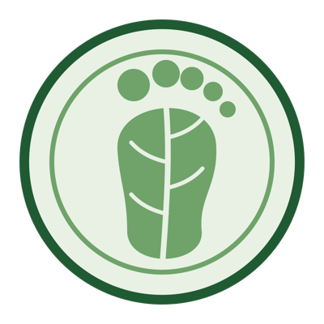

<!-- DATA PROVENANCE: Hackathon demo. Historical plates, serving quantities, costs and trends are simulated by api.seed; dish names use the USC Village menu catalog. These are not measured institutional outcomes. -->
<p align="center"></p>

# Plateprint

**Every plate leaves a print.** Feedback from what students eat, not what they say.

Plateprint is a camera over the dish return at USC Village Dining Hall that measures
what comes back uneaten. Each plate becomes anonymous numbers (dish, ml, grams) for a
staff dashboard and a weekly report. It stores plates, never people: no student app,
no IDs, no faces, and no frame is ever written to disk.

> Formerly *Leftover Lens*. The code, Python packages and `LEFTOVER_*` environment
> variables keep the old name so nothing breaks.

## Why

* U.S. college campuses throw out an estimated 22 million lb of food a year
  ([Food Recovery Network, via Higher Ed Dive](https://www.highereddive.com/news/college-combat-food-waste/510987/)).
* USC Dining collects feedback through QR codes on every table, but USC's associate
  director for residential dining told the Daily Trojan that not many students submit
  responses ([Daily Trojan, Mar. 2025](https://dailytrojan.com/2025/03/06/new-advisory-board-aims-to-include-student-perspectives/)).
  The form asks broad 1-5 questions and never asks which dish
  ([Daily Trojan, Oct. 2024](https://dailytrojan.com/2024/10/04/the-dining-hall-experience-could-be-improved-heres-how/)).
* USC forecasts what to cook and composts what is left, but nothing measures plate waste
  per dish. Plateprint fills that gap.
* It works elsewhere: UGA cut food left on plates by 19% in one semester (about 15,000 lb)
  with an AI plate-waste camera
  ([UGA Auxiliary Services](https://auxiliary.uga.edu/raccoon-eyes-helps-dining-services-reduce-food-waste/)).
  USC aims for STARS Platinum by 2028
  ([Daily Trojan, Feb. 2024](https://dailytrojan.com/2024/02/26/usc-sustainability-ranking/)),
  and dish-level waste data supports its food-waste and purchasing work.

## The loop

```
plate returned -> camera measures leftovers -> waste by dish, every day -> menu & orders adjust -> better plates
```

## How it works

| Stage | Module | What it does |
| --- | --- | --- |
| 1. Capture | `capture/` | One sharp frame per plate from a phone or camera over the dish return; the 8.5 in (21.59 cm) plate sets the scale; frames with a face are dropped; nothing is saved |
| 2. Segment | `labeling/`, `vision/` | Grounding DINO + SAM 2.1 auto-label training masks offline; YOLO26n-seg (`village-v2`, trained on our Village photos) runs live through ONNX Runtime |
| 3. Measure | `depth/`, `portion/` | Depth Anything 3 depth, scaled by the plate's known size; plate-plane fit; volume in ml; grams = volume x bulk density |
| 4. Match | `menu/` | Imports today's Village menu; SigLIP 2 picks a region's dish from today's dishes in its category, or says "unknown" |
| 5. Report | `analytics/`, `api/`, `dashboard/` | FastAPI + SQLite store; Next.js dashboard: waste by dish, ranges, filters, CSV, weekly PDF and committee email |

Volume, with plate scale \(s = 21.59\,\text{cm} / d_\text{plate, px}\) and height
\(h_p\) of each food pixel above the fitted plate plane:

$$V \approx \sum_{p \in \text{food}} \max(0, h_p)\, s^2, \qquad m = \rho V$$

## Privacy by design

* Frames are processed in memory and never written to disk, on the rig or in the API.
* A YuNet face guard checks every frame before upload and **fails closed**: if the face
  model can't load, every plate is dropped.
* No student identity is collected at any stage. The database holds plates, dishes and
  numbers only.

## Run the dining dashboard

The administrator demo is now a working **two-tab dashboard** backed by the API:
all 37 seeded menu dishes, uncertainty ranges, simulated serving comparisons,
inline dish inspection, trends, CSV export, and weekly PDF/email previews.

```bash
# Terminal 1, from the repo root (Python environment installed as below)
python -m api.seed
LEFTOVER_STAFF_TOKEN=local-demo-staff LEFTOVER_DEVICE_TOKEN=local-demo-device python -m uvicorn api.main:app --host 127.0.0.1 --port 8000

# Terminal 2
cd dashboard
npm ci
cp .env.example .env.local
npm run dev
```

Open **http://127.0.0.1:3000**. This is a local demo; generated plate and serving data
is visibly labeled. No CV weights are needed to explore it. No real CBORD connection
or email sending is claimed.

[Dashboard setup, metric definitions, workflow research and judging walkthrough](dashboard/README.md)
· [Verification evidence](docs/DASHBOARD_VERIFICATION.md)

## Live end-to-end test (15 Nov 2026)

Real phone photos of Village plates, posted to the running API (`POST /plates/image`)
on a Mac with `village-v2.onnx`, DA3-Small and SigLIP 2, against the 14 Nov Village menu
(`LEFTOVER_MENU_DATE=2026-11-14`). Details and caveats: [docs/MEASUREMENT.md](docs/MEASUREMENT.md).

| Plate | Matched dish | ml | g (unvalidated) |
| --- | --- | ---: | ---: |
| Rice | Rice Pilaf | 119.5 | 87.2 |
| Fries | Assorted French Fries | 37.5 | 18.8 |
| Chicken + asparagus (held-out plate) | Garlic and Herb Roasted Chicken | 99.6 | 58.8 |
| | Roasted Lemon Zest Asparagus | 137.0 | 82.2 |
| Rice + chicken | Rice Pilaf | 97.4 | 71.1 |
| | Garlic and Herb Roasted Chicken | 66.8 | 39.4 |

All 6 foods on 4 plates were matched to the right dish. This is a smoke test, not an
evaluation: **grams have not been checked against a scale**, and volume moves one-for-one
with the camera's focal length, which is uncalibrated (15-35% spread).

## Demo with a phone

The API and dashboard as in [Run the dining dashboard](#run-the-dining-dashboard), then either:

* **Photo (simplest):** take an overhead photo of the plate (35-45 cm above, whole plate
  in frame), AirDrop it to the Mac, then
  ```bash
  sips -s format jpeg -Z 1600 ~/Downloads/IMG_XXXX.HEIC --out plate.jpg
  curl -s -H "Authorization: Bearer local-demo-device" -F image=@plate.jpg -F meal=Dinner \
    http://127.0.0.1:8000/plates/image | python -m json.tool
  ```
* **Live rig:** iPhone as a Continuity Camera (locked, mounted screen up with the back
  camera pointing down at the tray), then
  ```bash
  LEFTOVER_DEVICE_TOKEN=local-demo-device python -m capture --meal Dinner --source 0 \
    --motion-threshold 6 --min-sharpness 20
  ```
  Give the terminal app camera access in System Settings, Privacy & Security, Camera.

The food must be on the menu for `LEFTOVER_MENU_DATE`, or it comes back "unknown".

## Status

| Module | State |
| --- | --- |
| `menu/` importer, cleaner, categorizer | Working, tested against a real Village menu |
| `portion/` grams and percent left | Working, tested; grams not yet validated against a scale |
| `depth/` plane fit, height map, volume, DA3 wrapper | Working; DA3-Small run on real Village photos (Colab and Mac); food-edge margin in the plane fit, trimmed refit off by default |
| `capture/scale.py` plate-ellipse scale | Working on synthetic geometry and real photos (camera height 21-46 cm recovered) |
| `menu/matcher.py` SigLIP 2 match to today's menu, `eval/matching.py` | Run on real photos: 6 of 6 foods matched in the live test; thresholds untuned |
| `labeling/autolabel.py` Grounding DINO + SAM 2.1 | Run on all 85 Village photos in Colab; filtered, with missing-food and manual exclusion reports |
| `augment/` copy-paste and lighting augmentation, composites into train only | Working, tested; 200 composites used for v1 and v2 |
| `eval/segmentation.py`, `eval/compare.py` | Working; real results committed in `eval/results/` |
| `vision/` train, ONNX export, inference | `village-v2` (1024 px) trained and shipped; `village-v1` (640 px) kept for comparison |
| `capture/` source, plate trigger, YuNet face guard, rig loop `python -m capture` | Tested on synthetic frames and against the API; iPhone Continuity Camera opens; trigger thresholds untuned |
| `api/` | All endpoints in `docs/CONTRACTS.md` work on SQLite; `POST /plates/image` runs the full pipeline on real photos; regions under 2 ml dropped; `LEFTOVER_MENU_DATE` replays a past menu for demos |
| `analytics/`, `python -m api.seed` demo data (labelled `seeded`) | Working, tested |
| `dashboard/` | Working Next.js two-tab module on FastAPI. See `dashboard/README.md`. |
| Grams eval (needs weighed plates) | Not measured yet. |

## Results

Every number here is copied from a file that an `eval/` script wrote under `eval/results/`;
nothing is typed by hand. Models, limits and licences: [MODEL_CARD.md](MODEL_CARD.md).
The photos, labelling and splits: [DATA_CARD.md](DATA_CARD.md).

#### Segmentation: village-v2, the shipped model (`eval/results/village-v2.json`)

Held-out plates at 1024 px, mask mAP50 0.756, mask mAP50-95 0.615.

| Class | Val images | Val instances | Precision | Recall | Mask AP50 | Mask AP50-95 |
|---|---:|---:|---:|---:|---:|---:|
| plate | 19 | 19 | 0.954 | 1.000 | 0.995 | 0.954 |
| bowl * | 2 | 2 | 1.000 | 0.000 | 0.495 | 0.198 |
| poultry * | 3 | 3 | 1.000 | 0.900 | 0.995 | 0.995 |
| cooked_vegetables | 3 | 12 | 0.658 | 0.583 | 0.623 | 0.371 |
| potatoes_fried_roasted | 12 | 26 | 0.559 | 0.654 | 0.669 | 0.556 |

\* fewer than 5 validation instances: too few to trust.
Classes with no validation instances are not listed; they have no held-out score.

#### v1 (640 px) vs v2 (1024 px), same held-out photos (`python -m eval.compare village-v1 village-v2`)

| | village-v1 | village-v2 (1024 px) |
|---|---:|---:|
| Mask mAP50, all classes | 0.755 | 0.756 |
| Mask mAP50-95, all classes | 0.545 | 0.615 |
| plate AP50 | 0.995 | 0.995 |
| plate AP50-95 | 0.950 | 0.954 |
| bowl * AP50 | 0.745 | 0.495 |
| bowl * AP50-95 | 0.124 | 0.198 |
| poultry * AP50 | 0.995 | 0.995 |
| poultry * AP50-95 | 0.995 | 0.995 |
| cooked_vegetables AP50 | 0.379 | 0.623 |
| cooked_vegetables AP50-95 | 0.185 | 0.371 |
| potatoes_fried_roasted AP50 | 0.664 | 0.669 |
| potatoes_fried_roasted AP50-95 | 0.470 | 0.556 |

\* fewer than 5 validation instances in at least one run: too few to trust.

How to read it:
* Training at 1024 px instead of 640 px is the one change between v1 and v2. It mostly helped
  thin foods: asparagus spears (`cooked_vegetables`) and tighter fries masks (AP50-95).
* The validation set is 19 real photos from three whole plates held out by plate
  (`asparagus+chicken_p1`, `empty_p1`, `fries_p4`); no photo of those plates, and no
  composite made from them, was trained on.
* There is no separate test set: the same 19 photos also chose the best epoch, so these
  numbers are likely somewhat optimistic.
* Rice, burger, short ribs and crepe were photographed at only one sitting each, so they have
  no held-out score at all.
* Not measured yet by an eval script: grams (no weighed plates) and menu-matching accuracy.
  See [Live end-to-end test](#live-end-to-end-test-15-nov-2026) for the first real run.

## Limitations and next steps

* **Validate grams** by weighing a set of plates, then calibrate densities.
* **Calibrate the rig camera's focal length** once; volume scales with it.
* Small dataset (85 photos): rice, burger, short ribs and crepe have no held-out score,
  and stacked fries are measured on their top layer only.
* The same rice photo gives 137 ml on Colab and 119 ml on a Mac; not explained yet.
* A one-week pilot at USC Village with USC Hospitality, compared against their own waste
  audits. The USC Hospitality logo in the dashboard needs their approval before any
  public deployment.
* Licensing: Ultralytics YOLO is AGPL-3.0; see [MODEL_CARD.md](MODEL_CARD.md).
* Cost and CO2e factors in the dashboard are placeholders.

## Run it

```bash
python -m venv .venv && source .venv/bin/activate     # Python 3.11
pip install -e ".[dev]"
cp .env.example .env                                  # then set LEFTOVER_DEVICE_TOKEN

python -m menu                                        # today's plate candidates
python -m menu --file tests/fixtures/village_2026-11-14.json
uvicorn api.main:app --reload                         # http://localhost:8000/docs

ruff check . && ruff format --check . && mypy . && pytest
```

Or `docker compose up --build` for the API on port 8000.

The rig (phone or camera over the dish return, posting each plate to the API):

```bash
pip install -e ".[dev,vision]"
curl -L -o models/face_detection_yunet_2023mar.onnx \
  https://github.com/opencv/opencv_zoo/raw/main/models/face_detection_yunet/face_detection_yunet_2023mar.onnx
set -a; source .env; set +a                           # nothing loads .env automatically
python -m api.seed                                    # optional: 4 weeks of labelled demo data
python -m capture --meal Dinner                       # start with the slot empty
```

Extras: `.[vision]` for the live rig (OpenCV, ONNX Runtime), `.[train]` for
Ultralytics training, `.[match]` for SigLIP. Grounding DINO and SAM 2.1 run in
`notebooks/colab_autolabel.ipynb` through Hugging Face `transformers`; Depth Anything 3 is
installed from its own repository on the GPU machine.

## The menu stage

`python -m menu` prints what the camera is allowed to recognize for each meal.
The pipeline is `menu/importer.py` (API, then cache, then a hand-entered
file), `menu/cleaner.py` (roles, merging, implied dishes) and
`menu/categorizer.py` (dish to coarse category). The rules are data, in
`menu/data/*.yaml`; a dish the rules get wrong is fixed with one line in
`menu/data/overrides.yaml`.

## Repository layout

```
core/        shared types: FoodCategory, FoodRegion, PortionEstimate
capture/     camera source, plate trigger, plate scale, face guard, rig loop
models/      model files (git-ignored); see models/FACE_MODEL.md
labeling/    Grounding DINO + SAM 2.1 auto-labeling, Voxel51 converter, pilot dish list
augment/     copy-paste, geometric and photometric augmentation
vision/      YOLO26n-seg training config, ONNX export, inference
depth/       depth model wrapper, plate plane, height map, volume
portion/     volume to grams, densities.yaml
menu/        Village menu importer, cleaner, categorizer
analytics/   per-dish aggregates and flags
api/         FastAPI app
eval/        evaluation scripts and committed results
tests/       unit tests per module, real menu fixture
```
